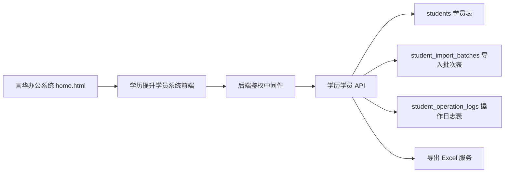

# 学历提升学员系统技术方案

## 1. 技术目标

在现有言华办公系统中新增真实数据库版“学历提升学员系统”，实现最高管理员专属的学员档案管理、Excel 导入导出、软删除回收站和操作审计。

当前前端项目为静态页面系统，接口地址通过 `config.js` 指向 `https://cip.hkjzyk.top`。本功能需要同时改造前端页面、后端接口和数据库结构。

## 2. 数据库类型建议

长期推荐使用 PostgreSQL 作为正式数据库；本次第一版先沿用当前线上后端已经使用的 SQLite + `better-sqlite3`。

原因：

- 学员数据属于长期业务数据，后续会持续按年份、批次增长。
- 需要导入导出、筛选、权限、审计日志、软删除，PostgreSQL 更适合结构化查询和后续扩展。
- 支持事务，导入 Excel 时可保证同一批次成功或回滚。
- 支持索引、唯一约束和 JSON 字段，便于处理历史 Excel 的不规范备注。

本次第一版落地选择：

- 已确认线上后端位于 `/opt/yanhua-office/current`。
- 已确认线上数据库为 SQLite，数据库路径为 `/opt/yanhua-office/shared/data/app.db`。
- 第一版在原 SQLite 数据库内新增 3 张业务表，不迁移现有用户、工具、岗位、待办等数据。
- 部署前必须先执行线上数据库备份，并备份被覆盖的后端/前端文件。
- 后续当学员量、并发写入、权限模型或统计报表复杂度提升后，再规划从 SQLite 迁移到 PostgreSQL。
- 不建议继续使用纯 JSON 文件保存学员数据，因为并发写入、导入回滚、权限审计和数据恢复风险较高。

落地原则：第一版采用“原库加表”；未备份前不得执行建表或导入。

## 3. 系统架构



## 4. 前端模块设计

新增目录：

```text
tools/education-students/
  index.html
  app.js
  styles.css
```

前端职责：

- 从登录态读取当前用户。
- 调用权限接口或用户信息判断是否有 `educationStudentManage` 权限。
- 无权限时显示无权限状态，不渲染业务数据。
- 渲染学员列表、筛选、分页、详情、表单、导入预览、回收站。
- 调用后端真实接口完成 CRUD、导入导出和恢复。

导航入口：

- 后端工具配置新增“学历提升学员系统”。
- 位置在“待办系统”下方。
- 可见规则由后端根据权限返回工具列表。
- 如果当前工具配置暂不支持按用户权限返回，可前端兜底过滤，但后端接口仍必须强校验。

## 5. 后端接口设计

统一前缀：

```text
/api/education-students
```

### 5.1 权限

第一版与现有言华后台保持一致，所有接口校验：

```text
role === "admin"
```

当前系统多处接口通过请求参数或请求头传递 `role`、`username`，学历系统第一版按现有模式接入，并在接口层统一拦截非 `admin` 请求。后续安全增强建议改为真实 session/token 鉴权，并增加独立权限位 `educationStudentManage`。

### 5.2 API 清单

| 方法 | 路径 | 用途 |
| --- | --- | --- |
| GET | `/api/education-students` | 学员列表，支持筛选分页 |
| GET | `/api/education-students/:id` | 学员详情 |
| POST | `/api/education-students` | 新增学员 |
| PUT | `/api/education-students/:id` | 编辑学员 |
| DELETE | `/api/education-students/:id` | 软删除学员 |
| GET | `/api/education-students/recycle-bin` | 回收站列表 |
| POST | `/api/education-students/:id/restore` | 恢复学员 |
| POST | `/api/education-students/import/preview` | Excel 导入预览 |
| POST | `/api/education-students/import/commit` | 确认导入 |
| GET | `/api/education-students/export.xlsx` | 导出当前筛选结果 |
| GET | `/api/education-students/stats` | 统计卡片 |
| GET | `/api/education-students/logs` | 操作日志 |
| GET | `/api/education-students/:id/files` | 学员资料列表 |
| POST | `/api/education-students/:id/files` | 上传 1 个学员资料文件 |
| GET | `/api/education-students/:id/files/:fileId/download` | 下载资料文件 |
| DELETE | `/api/education-students/:id/files/:fileId` | 删除资料文件 |

### 5.3 列表查询参数

```text
keyword
businessType
year
enrollmentBatch
level
targetEducation
pushInstitution
status
deleted
page
pageSize
sortBy
sortOrder
examRequiredCount
examStatus
examCompletion
examDateRange
examDateStart
examDateEnd
```

考试筛选参数说明：

| 参数 | 说明 |
| --- | --- |
| examRequiredCount | unknown / 1 / 2，其中 unknown 表示待确认 |
| examStatus | not_notified / notified / completed，可匹配任意一次考试状态 |
| examCompletion | incomplete / completed |
| examDateRange | today / next7days / overdue / custom，可匹配任意一次考试日期 |
| examDateStart | 自定义开始日期 |
| examDateEnd | 自定义结束日期 |

## 6. 数据库设计

### 6.1 education_students 表

| 字段 | 类型建议 | 说明 |
| --- | --- | --- |
| id | bigint / uuid | 主键 |
| name | varchar(50) | 姓名 |
| phone | varchar(30) | 联系方式 |
| business_type | varchar(20) | open_university / adult_exam |
| year | int | 招生年份 |
| enrollment_batch | varchar(20) | 3月 / 9月 / 待确认 |
| original_education | varchar(30) | 原始学历 |
| target_education | varchar(30) | 目标学历 |
| level | varchar(30) | 高起专 / 专升本 / 高起本 |
| original_school | varchar(100) | 原学校 |
| original_major | varchar(100) | 原专业 |
| intended_major | varchar(100) | 意向专业 |
| apply_school | varchar(100) | 报考学校 |
| intention_method | varchar(50) | 学历意向方式，保留 Excel 字段 |
| deal_date | date | 成交日期 |
| registration_fee | numeric(10,2) | 报名费 |
| final_payment | numeric(10,2) | 尾款，成考适用 |
| push_institution | varchar(50) | 推送机构，国开适用 |
| status | varchar(30) | 状态 |
| remark | text | 备注 |
| source_file | varchar(200) | 来源文件名 |
| import_batch_id | bigint / uuid | 导入批次 |
| created_by | varchar(80) | 创建人 |
| updated_by | varchar(80) | 更新人 |
| deleted_by | varchar(80) | 删除人 |
| delete_reason | varchar(200) | 删除原因 |
| created_at | timestamp | 创建时间 |
| updated_at | timestamp | 更新时间 |
| deleted_at | timestamp nullable | 软删除时间 |

国开线下考试字段补充：

| 字段 | 类型建议 | 说明 |
| --- | --- | --- |
| exam_required_count | integer nullable | 国开应参加考试次数，NULL 表示待确认，1 或 2 表示需参加次数 |
| exam_first_status | varchar(20) | 第一次考试状态：not_notified / notified / completed |
| exam_first_date | date nullable | 第一次线下考试首个日期，兼容旧字段 |
| exam_first_dates | text/json | 第一次线下考试日期数组，支持单次考试多天 |
| exam_second_status | varchar(20) | 第二次考试状态：not_notified / notified / completed |
| exam_second_date | date nullable | 第二次线下考试首个日期，兼容旧字段 |
| exam_second_dates | text/json | 第二次线下考试日期数组，支持单次考试多天 |
| exam_remark | text nullable | 考试备注 |

考试字段约束建议：

- 仅 `business_type = open_university` 时参与业务展示和筛选。
- `exam_required_count` 为 `NULL` 时表示“待确认”；因历史 SQLite 字段曾设置为非空，实际兼容实现允许使用 `0` 表示“待确认”，前端统一展示为“待确认”。
- `exam_required_count = 1` 时只使用第一次考试状态和第一次考试日期数组。
- `exam_required_count = 2` 时使用第一次和第二次考试状态、日期数组。
- `exam_first_dates`、`exam_second_dates` 用 JSON 数组保存，例如 `["2026-07-09","2026-07-11","2026-07-12"]`。
- 旧字段 `exam_first_date`、`exam_second_date` 保留为首个日期，便于兼容旧数据和旧导出逻辑；旧数据迁移时会自动转换为单元素数组。
- 单次考试完成与否由对应状态是否为 `completed` 判断。
- 成考学员写入时可将考试字段置空，前端不展示。

### 6.4 education_student_files 表

为支持学员资料上传，新增附件表，不建议把文件直接写入 SQLite。

| 字段 | 类型建议 | 说明 |
| --- | --- | --- |
| id | bigint / uuid | 主键 |
| student_id | bigint / uuid | 关联学员 |
| original_name | varchar(255) | 原始文件名 |
| stored_name | varchar(255) | 后端存储文件名 |
| file_ext | varchar(20) | 扩展名 |
| mime_type | varchar(100) | MIME 类型 |
| file_size | bigint | 文件大小，单位字节 |
| storage_path | varchar(500) | 相对上传目录的存储路径 |
| remark | varchar(500) | 文件备注 |
| uploaded_by | varchar(80) | 上传人 |
| uploaded_at | timestamp | 上传时间 |
| deleted_by | varchar(80) nullable | 删除人 |
| deleted_at | timestamp nullable | 软删除时间 |

文件存储建议：

- 线上上传根目录建议使用 `/opt/yanhua-office/shared/uploads/education-students/`。
- 按学员 ID 分目录，例如 `education-students/{studentId}/{timestamp-random.ext}`。
- 数据库只保存相对路径，例如 `{studentId}/{storedName}`。
- 部署同步默认必须排除上传目录，避免本地文件覆盖线上资料。
- 上传目录必须跟 SQLite 数据库一起纳入备份。

建议索引：

- `(business_type, year)`
- `(business_type, year, enrollment_batch)`
- `(push_institution)`
- `(deleted_at)`
- `(name, phone)`
- 全文/模糊搜索可先用普通 `LIKE`，数据量增长后再优化。

### 6.2 education_student_import_batches 表

| 字段 | 类型建议 | 说明 |
| --- | --- | --- |
| id | bigint / uuid | 主键 |
| file_name | varchar(200) | 文件名 |
| business_type | varchar(20) | 导入业务类型 |
| year | int | 年份 |
| total_rows | int | 预览总行数 |
| imported_rows | int | 成功导入行数 |
| skipped_rows | int | 跳过行数 |
| error_rows | int | 异常行数 |
| duplicate_strategy | varchar(30) | skip / update / merge |
| created_by | varchar(80) | 操作人 |
| created_at | timestamp | 操作时间 |

### 6.3 education_student_operation_logs 表

| 字段 | 类型建议 | 说明 |
| --- | --- | --- |
| id | bigint / uuid | 主键 |
| student_id | bigint / uuid nullable | 关联学员 |
| action | varchar(50) | create / update / delete / restore / import / export |
| operator | varchar(80) | 操作人 |
| detail | jsonb / text | 变更摘要 |
| created_at | timestamp | 操作时间 |

## 7. 导入规则

### 7.1 字段映射

国开和成考统一映射到 `students` 表：

| Excel 字段 | 数据库字段 |
| --- | --- |
| 姓名 | name |
| 联系方式 | phone |
| 原始学历 | original_education |
| 目标学历 | target_education |
| 原学校 | original_school |
| 原专业 | original_major |
| 意向专业 | intended_major |
| 报考学校 | apply_school |
| 学历意向方式 | intention_method |
| 成交日期 | deal_date |
| 报名费 | registration_fee |
| 尾款 | final_payment |
| 备注 | remark |

补充字段：

- `business_type` 由导入时选择或文件类型确定。
- `year` 由导入时选择或文件名识别。
- `level` 由原始学历和目标学历推断。
- `push_institution` 从备注识别或人工选择。
- `source_file` 保存源文件名。
- `import_batch_id` 保存导入批次。

### 7.2 重复识别

第一版建议重复判断键：

```text
姓名 + 联系方式 + 业务类型 + 年份 + 入学批次
```

成考如果无入学批次，可使用：

```text
姓名 + 联系方式 + 业务类型 + 年份
```

重复处理策略：

- 跳过：保留已有数据。
- 覆盖：用新导入字段覆盖旧数据。
- 合并备注：基础字段不覆盖，仅追加备注和导入来源。

### 7.3 校验规则

- 姓名为空：阻止导入。
- 联系方式为空：阻止导入。
- 手机号不足 11 位或包含异常字符：允许导入但标记“需复核”。
- 国开推送机构为空：新记录阻止保存；历史导入可进入“待确认”。
- 日期无法解析：允许空值导入并标记异常。
- 金额无法解析：允许空值导入并标记异常。

## 8. 删除与回收站

删除接口不执行物理删除，只更新：

```text
deleted_at
deleted_by
delete_reason
```

正常列表默认过滤 `deleted_at is null`。

回收站列表只展示 `deleted_at is not null`。

恢复操作清空删除字段，并写入操作日志。

## 9. 导出方案

导出类型：

- 当前筛选结果。
- 全部正常学员。
- 回收站数据。
- 按业务类型导出。

导出字段顺序应贴近原 Excel，但增加系统字段：

- 年份。
- 业务类型。
- 入学批次。
- 学历层次。
- 推送机构。
- 状态。
- 应参加考试次数。
- 第一次考试状态。
- 第一次考试日期。
- 第二次考试状态。
- 第二次考试日期。
- 考试备注。
- 资料数量。
- 创建时间。
- 更新时间。

导出操作必须写日志，记录导出人、导出条件和导出条数。

考试字段导出规则：

- 国开学员导出真实考试字段。
- 成考学员考试字段导出为空或“-”。
- 按考试筛选后的导出应只导出当前筛选结果。

## 9.1 国开线下考试接口与前端改造

后端改造：

- 列表接口返回考试字段和考试状态中文标签。
- 详情接口返回考试字段。
- 新增和编辑接口接收考试字段，并只对国开学员校验。
- 统计接口可扩展返回考试待通知、已通知未完成、已完成、近期考试、逾期未完成。
- 导出接口追加考试字段。
- 新增资料上传、列表、下载、删除接口。
- 上传接口采用 `multipart/form-data`，单次只接收 1 个文件。
- 上传文件扩展名白名单：doc、docx、pdf、ppt、pptx、xls、xlsx。
- 删除文件建议软删除附件记录，并保留物理文件到备份周期结束；如必须物理删除，应先确认。
- 关键修改写入操作日志。

前端改造：

- 列表新增考试次数、考试进度、考试状态、考试日期展示。
- 筛选区新增考试次数、考试状态、完成情况、考试日期筛选。
- 新增/编辑抽屉增加“线下考试信息”分组。
- 新增/编辑抽屉增加“学员资料”分组，支持上传、列表、下载、删除。
- 成考学员隐藏考试字段。
- 国开学员保存前校验考试次数与两次考试状态、日期关系。
- 考试临近和逾期未完成状态在列表中高亮提示。

第一版暂不做：

- 单独考试批次表。
- 考试地点管理。
- 短信或微信自动通知。
- 批量标记已完成。
- 考试信息 Excel 导入。
- 文件在线预览。
- 多文件同时上传。

## 10. 数据安全与部署方案

涉及线上数据库前必须执行：

1. 确认当前后端实际数据库类型和数据库路径/连接方式。
2. 备份线上数据库。
3. 备份上传目录、配置文件和运行时数据，如本次涉及。
4. 准备数据库迁移脚本。
5. 准备回滚脚本或回滚说明。
6. 先在测试环境或备份库验证迁移。
7. 用户确认后再执行线上迁移。

部署默认排除：

- 数据库文件。
- 上传文件。
- 日志文件。
- 缓存文件。
- 运行时生成文件。
- `.DS_Store`。

## 10.1 本次实现文件范围

后端完整项目目录：

```text
/Users/wangjinlong/Documents/Codex/99_归档/旧版本备份/言华教育工具系统-GenRenXiTong旧版
```

本次已实现或计划上线的后端文件：

```text
backend/db/index.js
backend/server.js
backend/routes/tools.js
backend/routes/educationStudents.js
frontend/tools/education-students/index.html
frontend/tools/education-students/app.js
frontend/tools/education-students/styles.css
```

当前静态前端项目新增文件：

```text
tools/education-students/index.html
tools/education-students/app.js
tools/education-students/styles.css
```

后端初始化数据库时会自动：

- 创建 `education_students`。
- 创建 `education_student_import_batches`。
- 创建 `education_student_operation_logs`。
- 如工具表中不存在“学历提升学员系统”，则插入工具入口，位置在“待办系统”之后。

工具入口由后端 `/api/tools` 控制：非 `admin` 用户过滤“学历提升学员系统”，`admin` 用户可见。

## 11. 验证清单

开发完成后必须验证：

- `node --check` 或等效语法检查通过。
- 页面本地可打开或开发服务可访问。
- 最高管理员可见入口。
- 普通用户不可见入口。
- 普通用户直接访问页面显示无权限。
- 普通用户调用接口返回 403。
- 列表、筛选、分页可用。
- 新增、编辑、软删除、恢复可用。
- 国开学员可新增和编辑考试字段。
- 成考学员不展示考试字段。
- 考试次数、考试进度、考试状态和考试日期在列表中展示正确。
- 考试次数、考试状态、完成情况和考试日期筛选可用。
- 待确认、需 1 次、需 2 次三种考试次数状态展示和保存规则正确。
- 需 2 次考试时，第一次和第二次考试状态、日期可分别保存。
- 导入预览可识别 4 个历史 Excel 文件。
- 导入提交后数据库记录数正确。
- 导出文件可打开，字段完整，包含考试字段。
- 桌面端截图自检通过。
- 移动端截图自检通过。
- 线上部署后验证服务状态、核心页面、接口和数据量。
- 线上部署后验证上传目录存在、权限正确、资料上传/下载/删除可用。
- 线上备份方案必须覆盖 SQLite 数据库和学员资料上传目录。

## 12. 风险与应对

| 风险 | 应对 |
| --- | --- |
| 当前后端数据库未知 | 先只读排查，不执行写入；确认后再定迁移方式 |
| 最高管理员账号未通过接口返回 | 由用户指定最高管理员账号，或新增权限位 |
| Excel 历史数据不规范 | 导入预览标记异常，允许人工修正 |
| 国开推送机构混在备注里 | 提供自动识别规则和人工确认 |
| 考试次数由人工维护，可能漏填或填错 | 默认待确认，列表提供待确认和待处理筛选 |
| 考试日期已过但状态未完成 | 列表红色提示，并提供逾期筛选 |
| 文件上传过大导致请求失败或服务压力过高 | 业务上不限制，但部署层设置可承受上限，并给出明确错误提示 |
| 上传目录未备份导致资料丢失 | 上传目录与数据库一起纳入备份和恢复方案 |
| 部署覆盖上传目录 | 部署脚本默认排除 `/shared/uploads`，严禁本地上传目录覆盖线上 |
| 误删学员 | 软删除进入回收站，不物理删除 |
| 普通用户绕过前端访问接口 | 后端所有接口强制鉴权 |
| 线上导入失败导致部分数据写入 | 使用事务和导入批次回滚 |

## 13. 分阶段实施建议

第一阶段：文档确认与权限确认。

- 确认最高管理员账号。
- 确认数据库类型。
- 确认字段和页面方案。

第二阶段：后端和数据库。

- 新增表结构。
- 新增 API。
- 新增权限校验。
- 准备导入预览和提交接口。

第三阶段：前端页面。

- 新增入口。
- 新增学员系统页面。
- 接入列表、表单、回收站、导入导出。

第四阶段：历史数据导入。

- 先备份。
- 预览 4 个 Excel。
- 用户确认异常行处理方式。
- 导入并核对数据量。

第五阶段：上线与验收。

- 按部署规范发布。
- 验证权限、页面、接口、数据量。
- 记录迭代和部署结果。
